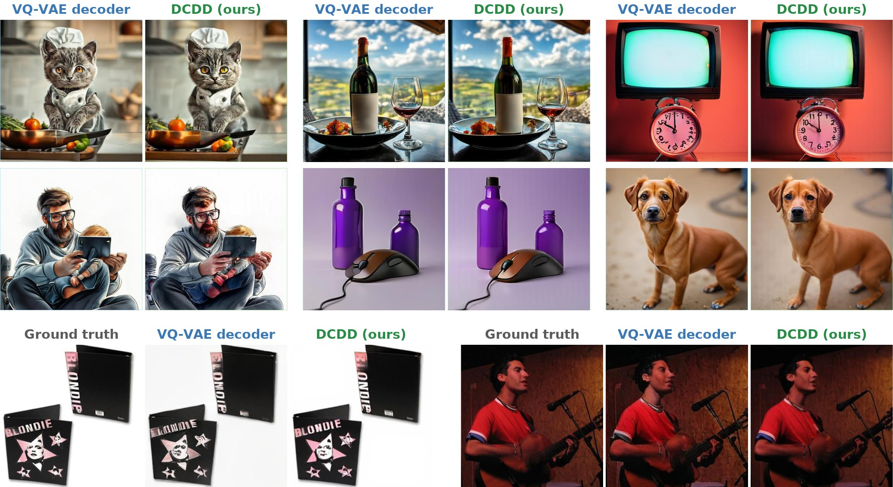
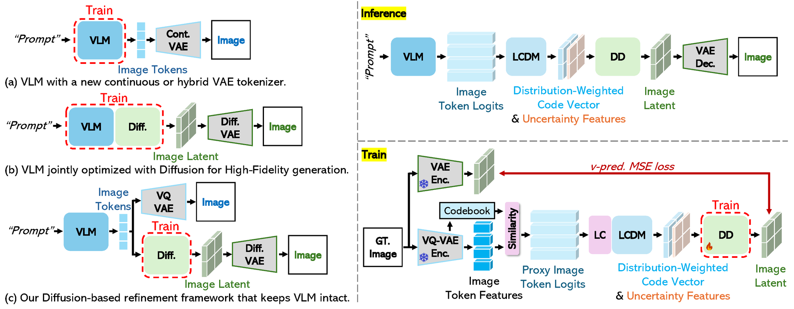

<div align="center">

# Logit-Conditioned Diffusion Decoding for Frozen Discrete-Token VLMs

<a href="https://arxiv.org/abs/2603.13389"></a>
<a href="https://jiwoohong93.github.io/dcdd/"></a>
<a href="LICENSE.txt"></a>

<em>NeurIPS 2026 · Sydney, Australia</em>

<p>
<a href="https://jiwoohong93.github.io/">Ji Woo Hong</a><sup>1 *</sup>,
<a href="https://kookie12.github.io/">Gwanhyeong Koo</a><sup>1</sup>,
<a href="https://hee-suk-yoon.github.io/">Hee Suk Yoon</a><sup>1</sup>,
<a href="https://esyoon7.github.io/">Eunseop Yoon</a><sup>1</sup>,
<a href="https://eomsoohwan.github.io/">SooHwan Eom</a><sup>1</sup>,
<br>
<a href="https://www.microsoft.com/en-us/research/people/qid/">Qi Dai</a><sup>2</sup>,
<a href="https://www.microsoft.com/en-us/research/people/cluo/">Chong Luo</a><sup>2 &dagger;</sup>,
<a href="http://sanctusfactory.com/family.php">Chang D. Yoo</a><sup>1 &dagger;</sup>
</p>
<p>
<sup>1</sup> Korea Advanced Institute of Science and Technology (KAIST) &nbsp;&nbsp;
<sup>2</sup> Microsoft Research Asia (MSRA)
<br>
<sub><sup>*</sup> Work done during an internship at MSRA. &nbsp;&nbsp; <sup>&dagger;</sup> Corresponding authors.</sub>
</p>

<p>
<a href="https://www.kaist.ac.kr/en/"></a>
&nbsp;&nbsp;&nbsp;&nbsp;&nbsp;&nbsp;
<a href="https://www.microsoft.com/en-us/research/lab/microsoft-research-asia/"></a>
</p>



</div>

**DCDD** (Distribution-Conditioned Diffusion Decoder) is a post-hoc decoder for
pre-trained **discrete-token vision-language models** such as Janus-Pro. Before each
image token is sampled, the VLM computes a full logit distribution over the VQ-VAE
codebook, but standard decoding keeps only the selected index and throws the rest away.
DCDD conditions a diffusion decoder on this discarded distribution, recovering fine detail
that the native VQ-VAE decoder loses, **without touching the VLM**. The VLM stays frozen,
the native decoding path remains available, and DCDD acts as an optional, higher-fidelity
alternative at decode time.

## Highlights

- **No VLM retraining.** Only the diffusion decoder (FLUX.1-Fill-dev, attention and adapter
  layers) is trained. Janus-Pro is used as is.
- **Logit-level conditioning.** At inference, the VLM's pre-sampling logits are converted
  into distribution-weighted code vectors and uncertainty features that condition the decoder.
- **Calibrated proxy training.** The decoder is trained on ImageNet-1K using VQ-VAE
  encoder-derived proxy logits, calibrated to match the statistics of the VLM's
  inference-time logits, so no VLM-generated data is needed for training.
- **Large fidelity gains, semantics preserved.** On Janus-Pro 7B, DCDD reduces
  reconstruction FID by 74% on ImageNet-1K and generation FID on MJHQ-30K by 34%, while
  GenEval, DPG-Bench, and WISE scores remain stable.
- **The gain comes from the logits.** Controlled comparisons against an image-to-image
  refiner and an identically trained decoder on sampled codes show that conditioning on the
  pre-sampling distribution, not the diffusion model itself, drives the improvement.

<div align="center">

<br>
<sub>Left: strategies for improving fidelity of discrete-token VLMs, by which components are trained.
Right: the DCDD framework. LCDM maps logits to decoder conditioning; LC calibrates training-time proxy logits to the VLM's inference-time statistics; DD is the diffusion decoder.</sub>
</div>

---

## Installation

With Conda installed, run:

```bash
git clone https://github.com/jiwoohong93/dcdd_code.git
cd dcdd_code
bash setup_env.sh
conda activate "$PWD/.conda"
hf auth login
```

The setup installs Python 3.10, PyTorch 2.5.1, and CUDA 12.4 packages. Accept the
access terms for [FLUX.1-Fill-dev](https://huggingface.co/black-forest-labs/FLUX.1-Fill-dev)
with your Hugging Face account before running the code. FLUX.1-Fill-dev and
[Janus-Pro-7B](https://huggingface.co/deepseek-ai/Janus-Pro-7B) are downloaded on
first use. Set `INSTALL_WANDB=1` before `setup_env.sh` to install the optional
Weights & Biases integration.

Run the commands below from the repository directory with this environment active.
All scripts are configured through environment variables; the examples below show
the ones you need to set. Each `.sh` file lists the remaining variables and their
defaults.

## Data preparation

Prepare ImageNet (`ILSVRC2012_img`) and the metadata for MJHQ and GenEval:

```text
datasets/
├── ILSVRC2012_img/
│   ├── train/
│   │   └── ... image files or class folders ...
│   └── val/
│       └── ILSVRC2012_val_00000001.JPEG, ...
├── mjhq30k_imgs/
│   ├── meta_data.json
│   └── val/
│       └── ... reference images grouped by category ...
└── geneval/
    └── prompts/
        └── evaluation_metadata.jsonl
```

- ImageNet-1K: [image-net.org](https://www.image-net.org/) (ILSVRC2012 train and val).
- MJHQ-30K: [playgroundai/MJHQ-30K](https://huggingface.co/datasets/playgroundai/MJHQ-30K)
  provides `meta_data.json` and the reference images.
- GenEval: `evaluation_metadata.jsonl` from the
  [GenEval repository](https://github.com/djghosh13/geneval).

Set the directory containing these datasets once before running the examples:

```bash
export DATA_DIR="$PWD/datasets"
```

If your datasets are stored elsewhere, replace `$PWD/datasets` with their parent
directory. Training and reconstruction both take the **ImageNet root**
(`ILSVRC2012_img`), rather than its `train/` or `val/` subfolder.

## Pipeline overview

1. **Calibration** (optional): estimate the logit-calibration parameters from the VLM.
2. **Training**: train the DCDD decoder on ImageNet-1K.
3. **Reconstruction** and **T2I generation**: decode with the trained checkpoint.
4. **Evaluation**: compute FID, SSIM, and LPIPS.

## Calibration

`janus_calibration_analysis.py` estimates the Logit Calibration (LC) parameters by
matching the statistics of VQ-VAE proxy logits to those of the VLM's inference-time
logits.

```bash
CALIB_DIR="$DATA_DIR/ILSVRC2012_img/train" \
GENEVAL_META="$DATA_DIR/geneval/prompts/evaluation_metadata.jsonl" \
OUT_TXT=outputs/calibration/janus_calibration.txt \
GPU=0 SEED=42 \
bash janus_calibration_analysis.sh
```

Use the resulting TXT file for both training and reconstruction, and retain it
with your checkpoint. Calibration is optional: omitting `CALIBRATION_FILE` uses
the default scale and smoothing of the paper (`JANUS_COSINE_SCALE=29.0381`,
`JANUS_LABEL_SMOOTHING_EPS=0.01`).

## Training

`train_flux_janus-pro-7b.py` trains the DCDD decoder on all images under
`ILSVRC2012_img/train/`.

```bash
DATAROOT="$DATA_DIR/ILSVRC2012_img" \
CALIBRATION_FILE=outputs/calibration/janus_calibration.txt \
OUTPUT_DIR=trained-flux_janus-pro-7b \
GPU=0,1,2,3 NUM_PROCESSES=4 \
SEED=42 MAX_TRAIN_STEPS=50000 CHECKPOINTING_STEPS=10000 \
bash train_flux_janus-pro-7b.sh
```

The default learning rate is `2e-5` and effective batch size is 32
(1 image per GPU, 8 gradient-accumulation steps, 4 GPUs), matching the paper's setting
on 4x A100 80GB. Checkpoints are saved as `trained-flux_janus-pro-7b/checkpoint-10000`,
`checkpoint-20000`, and so on. To resume, add `RESUME_FROM=/path/to/checkpoint` to the
command. For a new run, choose a new `OUTPUT_DIR`; the script refuses to overwrite an
existing run directory. Set `REPORT_TO=wandb` to log to Weights & Biases.

## Reconstruction

`janus_reconstruction.py` reconstructs **all images under the `val/` subfolder**
of the specified ImageNet root.

```bash
CKPT_DIR=trained-flux_janus-pro-7b/checkpoint-50000 \
DATA_ROOT="$DATA_DIR/ILSVRC2012_img" \
OUT_PATH=outputs/reconstruction \
CALIBRATION_FILE=outputs/calibration/janus_calibration.txt \
GPU=0,1 NPROC=2 \
bash janus_reconstruction.sh
```

Outputs preserve the input paths, for example
`outputs/reconstruction/val/ILSVRC2012_val_00000001.JPEG`. Existing outputs are skipped.
To reconstruct a smaller subset, add `MAX_ITEMS=1000`; the default `MAX_ITEMS=0`
processes the full validation set. For one GPU, use `GPU=0 NPROC=1`. Use
`BATCH_SIZE` to adjust the per-GPU batch size and `STEPS` to change the number of
denoising steps.

## T2I generation

Both generation scripts save native Janus VQ-VAE images in `vqvae/` and DCDD
images in `diff/` under the output directory, so the two decoders can be compared on
identical sampled tokens. Set `CKPT_DIR` to your trained checkpoint. Existing outputs
are skipped. Janus sampling uses `CFG=5.0` and `TEMP=1.0` by default, matching the
paper and the calibration settings.

### MJHQ

`janus_t2i_mjhq.py` generates images for **all MJHQ categories** by default.

```bash
CKPT_DIR=trained-flux_janus-pro-7b/checkpoint-50000 \
META_JSON="$DATA_DIR/mjhq30k_imgs/meta_data.json" \
OUT_ROOT=outputs/mjhq \
GPU=0 \
bash janus_t2i_mjhq.sh
```

To select categories, add `CATEGORIES=animals` or a comma-separated list such as
`CATEGORIES=animals,art`. To test a few prompts, add `MAX_ITEMS=5`. To split the
prompt set across several GPUs, run one process per GPU with `NUM_SHARDS=<n>` and
`SHARD_ID=<0..n-1>`, pointing all of them at the same `OUT_ROOT`.

### GenEval

`janus_t2i_geneval.py` generates four images per prompt, with metadata and grids
in the format used by GenEval.

```bash
CKPT_DIR=trained-flux_janus-pro-7b/checkpoint-50000 \
META_JSONL="$DATA_DIR/geneval/prompts/evaluation_metadata.jsonl" \
OUT_ROOT=outputs/geneval \
GPU=0 \
bash janus_t2i_geneval.sh
```

Each prompt produces `samples/0000.png` to `0003.png`, `grid.png`, and
`metadata.jsonl` under `vqvae/<index>/` and `diff/<index>/`. To restrict the
prompt types, add `TAGS=single_object,two_objects`. Use the official GenEval
evaluator separately to score the generated images.

## Evaluation

`eval.py` measures FID, SSIM, and LPIPS. For the full ImageNet reconstruction:

```bash
CUDA_VISIBLE_DEVICES=0 python eval.py \
  --gt_folder "$DATA_DIR/ILSVRC2012_img/val" \
  --gen_folder outputs/reconstruction/val \
  --metrics fid,ssim,lpips \
  --save_json outputs/reconstruction_metrics.json
```

SSIM and LPIPS require matching relative filenames in the reference and output
folders. If you reconstructed a subset, use a reference folder containing only
the corresponding images.

For MJHQ generation FID:

```bash
CUDA_VISIBLE_DEVICES=0 python eval.py \
  --gt_folder "$DATA_DIR/mjhq30k_imgs/val" \
  --gen_folder outputs/mjhq/diff \
  --metrics fid \
  --save_json outputs/mjhq_gfid.json
```

FID requires non-empty folders with equal image counts; filenames and extensions
may differ. For category-specific generation, point both folders to that
category, for example `mjhq30k_imgs/val/animals` and `outputs/mjhq/diff/animals`.
Replace `diff` with `vqvae` to score the native decoder on the same tokens.

## Citation

If you find this work useful, please cite:

```bibtex
@inproceedings{hong2026dcdd,
  title     = {Logit-Conditioned Diffusion Decoding for Frozen Discrete-Token {VLMs}},
  author    = {Hong, Ji Woo and Koo, Gwanhyeong and Yoon, Hee Suk and Yoon, Eunseop and Eom, SooHwan and Dai, Qi and Luo, Chong and Yoo, Chang D.},
  booktitle = {Advances in Neural Information Processing Systems (NeurIPS)},
  year      = {2026}
}
```

## Acknowledgements

This research was supported by the MSIT (Ministry of Science, ICT), Korea, under the
Global Research Support Program in the Digital Field program (RS-2024-00436680)
supervised by the IITP (Institute for Information & Communications Technology Planning
& Evaluation).

This code builds on [Janus](https://github.com/deepseek-ai/Janus),
[FLUX.1-Fill-dev](https://huggingface.co/black-forest-labs/FLUX.1-Fill-dev), and
[Diffusers](https://github.com/huggingface/diffusers). We thank the authors for
releasing their models and code.

## License

DCDD is released under the [MIT License](LICENSE.txt). Bundled Janus code retains
its [upstream MIT license](janus/LICENSE); see
[third-party notices](THIRD_PARTY_NOTICES.md). Model weights and datasets remain
subject to their providers' licenses and terms.
